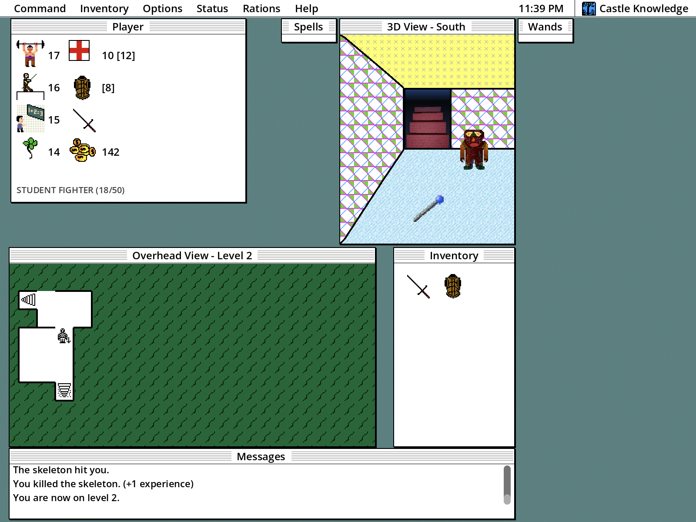

# castle-knowledge

Godot 4 rebuild of the Castle Knowledge shareware game for Macintosh (System 7).

[Play in Browser](https://andy191x.github.io/castle-knowledge/)

## What is Castle Knowledge?

An educational roguelike game originally released in 1995. It mixes dungeon exploration with "knowledge" puzzles (math, synonyms, state capitals, word scrambles, deduction). Dungeons and items are randomized making every playthrough unique.

This rebuild was AI assisted with Opus 5.5. The overall goal was to discover and reimplement the original ruleset while including some quality of life improvements. Changes from the original include:

* Support for modern displays with pixel scaling.
* Tooltips on all inventory, stats, and items.
* Messages window that displays game events.
* Puzzles are now entirely optional.
* In game debug tools.
* Balancing and bug fixes.

## Controls

* **Move forward:** W, Up, or click when the cursor shows an up arrow.
* **Turn left:** A, Left, or click when the cursor shows a left arrow.
* **Turn right:** D, Right, or click when the cursor shows a right arrow.
* **Attack:* Up, Shift, or click on the enemy.
* **Pick up item:** Spacebar.

## Game engine notes

* Built with Godot 4.6.
* Build templates configured for Windows, Mac, and Web
